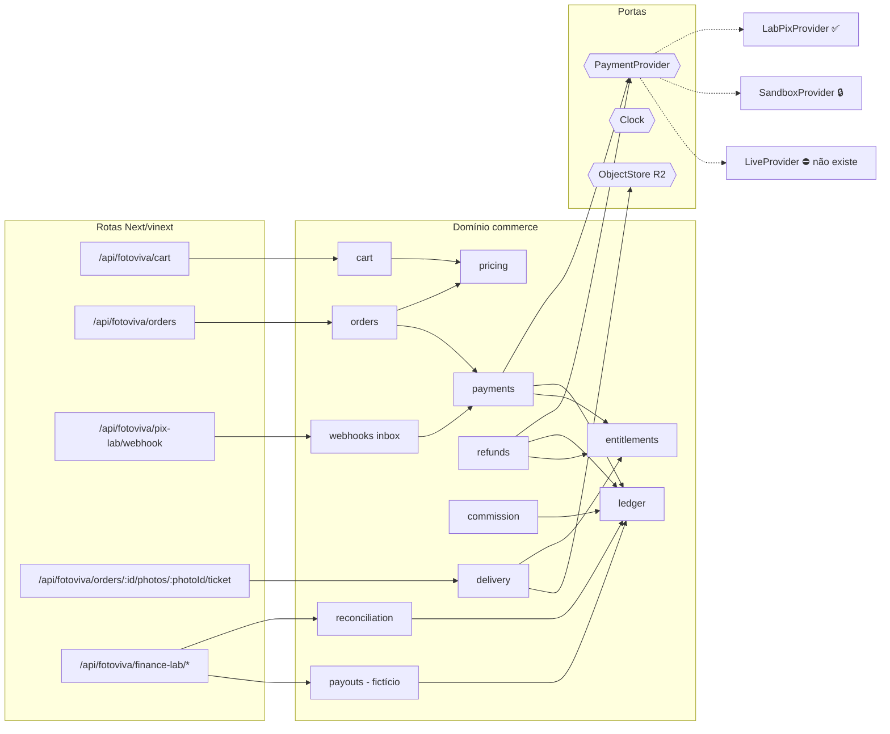

# F02 — Arquitetura de pagamentos

> **Status:** ✅ projetada · ⚠️ precisa ser mapeada aos módulos existentes (F01 §7) antes de implementar

## 1. Princípios

1. **O servidor é a autoridade.** Preço, total, comissão e estado vêm do backend. Valores enviados pelo navegador são ignorados.
2. **Centavos inteiros.** Tudo é `INTEGER` em centavos e as taxas são *basis points* (`2000` = 20%). Não se usa `float` em dinheiro.
3. **Toda escrita financeira é idempotente.** Cada operação tem uma chave única, e repeti-la não produz efeito.
4. **O ledger só aceita inserções.** Correções viram novos lançamentos; `UPDATE` e `DELETE` são bloqueados por trigger.
5. **O provedor é um detalhe.** O domínio conversa com a porta `PaymentProvider`. Simulador, sandbox e provedor real são adaptadores.
6. **Isolamento por ambiente.** Fora do laboratório, as rotas respondem `403` (padrão já existente). O adaptador *live* **não existe** nesta fase: a ausência de código é o próprio controle.

## 2. Módulos



| Módulo | Responsabilidade | Existe? (F01) | Depende de |
|---|---|---|---|
| `cart` | Seleção por sessão, itens indisponíveis | ✅ reaproveitar | `pricing` |
| `pricing` | Preço por foto e descontos; **função pura** `quote(items, catálogo)` | ✅ (preço no servidor) ⚠️ isolar como função pura | catálogo |
| `orders` | Snapshot imutável de itens e preços, chave de idempotência, validade | ✅ reaproveitar | `pricing`, `payments` |
| `payments` | Cria cobrança, aplica eventos e máquina de estados (F03) | ⚠️ endurecer | `PaymentProvider`, `ledger`, `entitlements` |
| `webhooks` | Caixa de entrada de eventos: verificação, deduplicação e registro | ⚠️ endurecer | `payments` |
| `refunds` | Estorno total ou parcial, idempotente | ⚠️ total parece existir; parcial ❌ | `PaymentProvider`, `ledger`, `entitlements` |
| `commission` | Regras versionadas e divisão por fotógrafo (F04) | ⚠️ | — |
| `ledger` | Partidas dobradas, somente inserção | ✅ (laboratório) ⚠️ incluir taxa do PSP | — |
| `payouts` | Saldo e lotes **fictícios** | ❌ criar | `ledger` |
| `reconciliation` | Invariantes do ledger e, no futuro, extrato do PSP | ✅ (`allReconciled`) | `ledger` |
| `entitlements` | Direito de download por item | ⚠️ tornar explícito (F05) | — |
| `delivery` | Tickets de uso único e streaming do R2 | ✅ endurecer (F05) | `entitlements`, R2 |

**Organização sugerida** (adaptar à convenção do repositório): `src/server/commerce/<módulo>/{index.ts, *.test.ts}`. As rotas ficam finas e só chamam o domínio.

## 3. A porta `PaymentProvider`

```ts
export type ProviderId = "lab" | "sandbox"; // "live" fica fora do tipo de propósito nesta fase

export interface CreateChargeInput {
  orderId: string;
  txid: string;            // gerado por nós; torna a criação idempotente (ver F03 §2)
  amountCents: number;     // vem do snapshot do pedido, nunca do navegador
  expiresInSeconds: number;
  description: string;     // sem dados pessoais
}

export interface ChargeCreated {
  providerChargeId: string;
  txid: string;
  expiresAt: number;       // epoch ms
  copyPaste?: string;      // BR Code "copia e cola" (só no sandbox ou live)
  qrPngBase64?: string;
}

export type ChargeStatus = "active" | "paid" | "expired" | "failed" | "refunded" | "partially_refunded";

export interface ChargeSnapshot { txid: string; status: ChargeStatus; amountCents: number; paidAmountCents?: number }

export interface VerifiedProviderEvent {
  providerEventId: string; // Pix: endToEndId do pagamento ou id da devolução
  type: "paid" | "failed" | "expired" | "refunded";
  txid: string;
  amountCents: number;
  occurredAt: number;
}

export interface PaymentProvider {
  readonly id: ProviderId;
  createCharge(input: CreateChargeInput): Promise<ChargeCreated>;
  getCharge(txid: string): Promise<ChargeSnapshot>;
  refund(input: { txid: string; refundId: string; amountCents: number }): Promise<{ status: "requested" | "done" }>;
  /** Lança InvalidSignatureError se a assinatura for inválida. Recebe o corpo BRUTO. */
  verifyWebhook(rawBody: Uint8Array, headers: Headers): Promise<VerifiedProviderEvent>;
}
```

**Seleção do adaptador** (fábrica única, sem *fallback* silencioso):

```ts
export function resolvePaymentProvider(env: Env): PaymentProvider {
  if (env.FV_LAB !== "1") throw new FeatureDisabledError("payments");       // → 403, igual ao gate atual
  switch (env.FV_PAYMENT_PROVIDER ?? "lab") {
    case "lab": return new LabPixProvider(env.DB, env.FV_LAB_WEBHOOK_SECRETS);
    case "sandbox": throw new FeatureDisabledError("payments.sandbox");      // 🔒 até o PSP ser aprovado
    default: throw new FeatureDisabledError("payments.unknown_provider");
  }
}
```

> `FV_LAB` e `FV_PAYMENT_PROVIDER` são nomes propostos. **Reaproveitar o flag de laboratório que já existe**, sem criar um paralelo.

## 4. Eventos de domínio

| Evento | Emitido por | Efeitos (na mesma transação, quando possível) |
|---|---|---|
| `OrderCreated` | `orders` | Snapshot de itens, `commission_rule_id`, `expires_at` |
| `ChargeCreated` | `payments` | Linha em `payment_charges` (`active`) |
| `PaymentConfirmed` | `payments` (via webhook) | Pedido `paid`, lançamentos, direitos `active` (F03 §5) |
| `PaymentRejected` | `payments` | Evento com `outcome` ≠ `applied`; se houver dinheiro recebido, `refund_required` |
| `ChargeExpired` | varredura e leitura | Pedido `expired` |
| `RefundRequested` / `RefundConfirmed` | `refunds` | Lançamentos de estorno, direitos `revoked` |
| `DeliveryIssued` / `DeliveryServed` / `DeliveryDenied` | `delivery` | Linha em `delivery_log` |
| `PayoutSimulated` | `payouts` | Lote fictício e lançamentos `payable → payout_clearing` |

## 5. Modelo de dados proposto

> ⚠️ **Antes de criar qualquer tabela**, mapeie-a para as tabelas existentes (F01 §8). As migrações são **apenas locais** (`wrangler d1 migrations apply --local`).

```sql
-- Regras de comissão versionadas (F04)
CREATE TABLE commission_rules (
  id TEXT PRIMARY KEY,
  scope TEXT NOT NULL CHECK (scope IN ('global','photographer','album')),
  scope_id TEXT,
  version INTEGER NOT NULL,
  platform_fee_bps INTEGER NOT NULL CHECK (platform_fee_bps BETWEEN 0 AND 10000),
  provider_fee_bps INTEGER NOT NULL CHECK (provider_fee_bps BETWEEN 0 AND 10000),
  provider_fee_fixed_cents INTEGER NOT NULL DEFAULT 0 CHECK (provider_fee_fixed_cents >= 0),
  provider_fee_bearer TEXT NOT NULL CHECK (provider_fee_bearer IN ('platform','photographer')),
  provider_fee_refundable INTEGER NOT NULL DEFAULT 0,
  hold_days INTEGER NOT NULL DEFAULT 7,
  valid_from INTEGER NOT NULL,
  valid_to INTEGER,
  created_by TEXT NOT NULL,
  UNIQUE (scope, scope_id, version)
);

-- Pedido: acrescentar à tabela existente, se faltar
--   commission_rule_id TEXT NOT NULL, paid_event_id TEXT, refund_id TEXT

CREATE TABLE payment_charges (...);      -- ver código de referência
CREATE TABLE payment_events (...);       -- caixa de entrada, UNIQUE(provider, provider_event_id)
CREATE TABLE ledger_entries (...);       -- UNIQUE(posting_key, account) + triggers de somente inserção

CREATE TABLE refunds (
  id TEXT PRIMARY KEY,
  order_id TEXT NOT NULL,
  scope TEXT NOT NULL CHECK (scope IN ('full','items')),
  amount_cents INTEGER NOT NULL CHECK (amount_cents > 0),
  reason TEXT NOT NULL CHECK (reason IN ('buyer_request','late_payment','amount_mismatch','duplicate_payment','moderation','admin')),
  status TEXT NOT NULL CHECK (status IN ('requested','done','failed')),
  requested_by TEXT NOT NULL,
  created_at INTEGER NOT NULL
);
CREATE TABLE refund_items (refund_id TEXT NOT NULL, order_item_id TEXT NOT NULL, PRIMARY KEY (refund_id, order_item_id));

CREATE TABLE download_entitlements (...); -- F05
CREATE TABLE delivery_log (...);          -- F05

-- Repasses FICTÍCIOS (F04)
CREATE TABLE payout_batches (
  id TEXT PRIMARY KEY,
  photographer_id TEXT NOT NULL,
  amount_cents INTEGER NOT NULL CHECK (amount_cents > 0),
  status TEXT NOT NULL CHECK (status IN ('simulated','canceled')),  -- não existe estado 'transferred'
  created_at INTEGER NOT NULL,
  created_by TEXT NOT NULL
);
```

O DDL completo e testado de `orders`, `order_items`, `payment_charges`, `payment_events`, `ledger_entries` e `download_entitlements` está em [codigo-de-referencia.md](codigo-de-referencia.md#4-confirmação-atômica-e-estorno-d1).

## 6. Fronteiras de segurança

| Fronteira | Controle |
|---|---|
| Navegador → API | Sessão (cookie `HttpOnly`) obrigatória; pedido de outro comprador responde **404** (não 403), para não confirmar que ele existe |
| Navegador → preço | O corpo de `POST /orders` aceita só `photoIds` e a chave de idempotência; qualquer `price`/`total` é ignorado e registrado em log como `client_price_ignored` |
| Provedor → webhook | Assinatura HMAC sobre o corpo bruto, janela de 300 s e deduplicação (F03). No live, também **mTLS** (🔒) |
| Ambiente | `FV_LAB` desligado → todas as rotas de commerce respondem 403 (padrão atual) |
| Segredos | Somente via `wrangler secret`; nunca no repositório, que é **público** |
| Administração | Estorno, ajuste e repasse simulado exigem o papel `finance_admin` e são registrados com o ator |

## 7. Como trocar de provedor

| Estágio | Adaptador | Pré-requisitos | Situação |
|---|---|---|---|
| Simulador | `LabPixProvider` | Nenhum | ✅ disponível (pix-lab) |
| Sandbox oficial | `SandboxProvider` | PSP escolhido, conta de sandbox e credenciais de teste em `wrangler secret`, revisão do Codex | 🔒 |
| Provedor autorizado | `LiveProvider` | Contrato, conta PJ, mTLS no domínio próprio, RIPD/LGPD, revisão do Codex, autorização formal | ⛔ fora do escopo |

Os testes de contrato (`provider.contract.test.ts`) rodam o **mesmo conjunto** contra qualquer adaptador. O sandbox só entra quando passar nesse conjunto.
