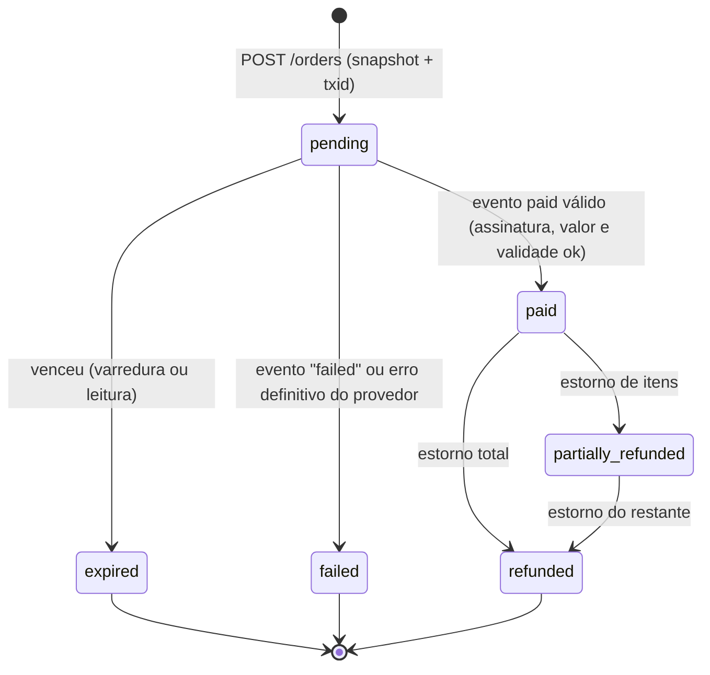

# F03 — Pix simulado

> **Status:** ✅ especificado · ✅ núcleo testado no código de referência (assinatura, deduplicação, confirmação atômica, expiração, divergência de valor, concorrência e estorno) · ⚠️ falta aplicar ao handler `pix-lab` existente
> **Regra:** nenhuma credencial financeira real. Sem chave Pix, QR Code ou BR Code reais.

## 1. Estados

O pedido existente já usa `pending`, `paid`, `failed`, `expired` e `refunded` (F01 §3). A cobrança (`payment_charges`) segue a mesma máquina de estados:



Transições ilegais (por exemplo, `expired → paid` e `refunded → paid`) **não acontecem** porque cada `UPDATE` exige o estado de origem no `WHERE`. Um evento que chega fora de ordem fica registrado com `outcome` explicativo (§5).

## 2. Identificadores

| Identificador | Formato | Origem | Função |
|---|---|---|---|
| `order.id` | UUID v4 | Servidor | Chave do pedido; aparece na URL `/pedido/:id` |
| `Idempotency-Key` | UUID v4 | Navegador (já existe) | `UNIQUE(buyer_subject, idempotency_key)` em `orders`; repetir devolve o mesmo pedido |
| `txid` | `[A-Za-z0-9]{26,35}`. Usamos 32 caracteres base62 a partir de 24 bytes aleatórios | **Servidor** | Identifica a cobrança, com o mesmo formato do `txid` da API Pix do BCB. Como é gerado por nós, a criação fica idempotente: repetir a criação com o mesmo `txid` não cria cobrança nova |
| `payment_events.id` | UUID v4 | Servidor, ao receber | Linha da caixa de entrada |
| `provider_event_id` | Texto | Provedor (no Pix real, o `endToEndId` de 32 caracteres) | Deduplicação: `UNIQUE(provider, provider_event_id)` |

## 3. Validade

- `expires_at = created_at + FV_PIX_TTL_SECONDS`. O padrão sugerido é **900 s** (15 min), configurável entre 300 e 3600.
- **Expiração preguiçosa:** toda leitura de `GET /orders/:id` executa `UPDATE orders SET status='expired' WHERE id=? AND status='pending' AND expires_at <= ?now` antes de responder.
- **Varredura:** um Cron Trigger do Worker a cada 5 min expira em lote (somente no laboratório).
- **Pagamento após a validade:** o evento é registrado com `outcome = 'late_payment'`, e o pedido **não** é liberado. Com um provedor real, isso significa que o dinheiro entrou, então é gerado um `refunds` com `reason='late_payment'` (devolução Pix) e o caso aparece na conciliação.

## 4. Webhook: verificação

Rota existente: `POST /api/fotoviva/pix-lab/webhook`, somente no laboratório.

Ordem obrigatória no handler:

1. Se `FV_LAB` estiver desligado, responder `403` (como hoje).
2. Ler o **corpo bruto** (`await request.arrayBuffer()`) com limite de **16 KB**; acima disso, `413`.
3. Verificar `X-FV-Lab-Signature: t=<unix>,v1=<hex>`. A assinatura é `HMAC-SHA256(segredo, "<t>.<corpo>")`, com tolerância de ±300 s e comparação em tempo constante (`crypto.subtle.verify`). Inválida → `401`, **sem** detalhar o motivo.
4. Só então fazer `JSON.parse` e validar o esquema: `type`, `txid`, `amountCents` (inteiro > 0), `providerEventId` (até 64 caracteres) e `occurredAt`.
5. Aplicar o evento (§5) e responder `200 {"received": true, "outcome": "..."}`. Inclusive para duplicatas: o provedor não deve reenviar para sempre.

- **Rotação de segredo:** `FV_LAB_WEBHOOK_SECRETS="novo,antigo"`. Os dois são aceitos durante a janela de rotação.
- **Defesa extra (sandbox e live):** depois de verificar o evento, chamar `provider.getCharge(txid)` e conferir o status e o valor na fonte, porque o conteúdo do webhook sozinho não basta.
- **Live:** a especificação da API Pix do BCB e os PSPs costumam exigir **mTLS** no webhook. No Cloudflare isso precisa de domínio próprio com regra de mTLS; `*.workers.dev` não atende. 🔒

Implementação testada: [codigo-de-referencia.md §1](codigo-de-referencia.md#1-assinatura-do-webhook).

## 5. Aplicação atômica do evento `paid`

O D1 não oferece transação interativa (ler, decidir, escrever), mas `db.batch([...])` executa uma lista de instruções **numa única transação**. O desenho:

1. **Fora do batch:** carregar o snapshot do pedido pelo `txid` e calcular os lançamentos (F04). O snapshot é imutável, então calcular antes é seguro.
2. **Dentro do batch:** cada instrução é protegida por uma condição. Só o evento que "venceu" a transição produz efeitos:

| # | Instrução | Proteção |
|---|---|---|
| 1 | `INSERT INTO payment_events … ON CONFLICT(provider, provider_event_id) DO NOTHING` | Deduplica pelo id do provedor |
| 2 | `UPDATE orders SET status='paid', paid_event_id=?evento WHERE … status='pending' AND expires_at > ?agora AND total_cents = ?valor AND EXISTS(evento inserido)` | Estado de origem, validade, valor e evento novo |
| 3 | `UPDATE payment_charges SET status='paid' WHERE … EXISTS(orders.paid_event_id = ?evento)` | Só se este evento venceu |
| 4 | `INSERT INTO ledger_entries SELECT … WHERE orders.paid_event_id = ?evento ON CONFLICT(posting_key, account) DO NOTHING` | Chave `payment:<orderId>`, que impede lançamento duplo mesmo com dois eventos diferentes |
| 5 | `INSERT INTO download_entitlements SELECT … ON CONFLICT(order_item_id) DO NOTHING` | Um direito por item |
| 6 | `UPDATE payment_events SET outcome = CASE … END` | `applied`, `unknown_charge`, `already_paid`, `amount_mismatch`, `late_payment` ou `not_pending` |
| 7 | `SELECT (id = ?evento) AS fresh, outcome …` | `fresh = 0` indica duplicata |

**Resultados verificados** (node:sqlite, que tem a mesma semântica de SQLite do D1, com o batch emulado em `BEGIN IMMEDIATE/COMMIT`):

| Cenário | `outcome` | Pedido | Lançamentos | Direitos |
|---|---|---|---|---|
| Evento válido | `applied` | `paid` | 4, soma 0 | 3 ativos |
| Mesmo evento reenviado | `applied` (`fresh=0`) | inalterado | inalterado | inalterado |
| Segundo pagamento com outro id | `already_paid` | inalterado | sem duplicação | inalterado |
| Valor divergente | `amount_mismatch` | `pending` | 0 | 0 |
| Após a validade | `late_payment` | não liberado | 0 | 0 |
| `txid` desconhecido | `unknown_charge` | — | 0 | 0 |
| Duas conexões leem antes e gravam depois | `applied` e `already_paid` | `paid` | soma 0 | 3 |

> **Dinheiro recebido e não aplicado** (`amount_mismatch`, `late_payment`, `already_paid` com outro `endToEndId`): no laboratório, o caso só fica registrado. Com um provedor real, gera um `refunds` automático e um alerta na conciliação.

## 6. Criação simulada da cobrança

`POST /api/fotoviva/orders` (existente) passa a:

1. Validar a sessão e a chave de idempotência. Se o pedido já existe, devolvê-lo.
2. Recalcular o preço com `pricing.quote()` a partir do catálogo atual. Fotos indisponíveis → `409 {code:"items_unavailable"}`.
3. Gravar o snapshot (`order_items.unit_price_cents`, `orders.total_cents` e `commission_rule_id`) e a cobrança `payment_charges(active)`, com `txid` novo, **no mesmo batch**.
4. Chamar `provider.createCharge()`. No laboratório, essa chamada não faz rede. No sandbox, se a chamada falhar, o pedido continua `pending` e a próxima tentativa reutiliza o **mesmo `txid`**, o que é seguro porque a criação com `txid` próprio é idempotente.

## 7. Consulta de status

`GET /api/fotoviva/orders/:id` (existente). Proposta: acrescentar o subobjeto `payment` sem quebrar os campos atuais (contrato em F10). Com isso, o cliente pode consultar sozinho a cada 3 s nos primeiros 2 min e depois com intervalo crescente, mantendo o botão "Atualizar situação" já existente.

## 8. Falhas de comunicação

| Falha | Comportamento |
|---|---|
| Timeout ao criar a cobrança | O pedido fica `pending` sem `copyPaste`; o usuário pode tentar de novo com o mesmo `txid` |
| Webhook não chega | A consulta de status chama `provider.getCharge()` (sandbox/live) e aplica um evento sintético `reconcile:<txid>` pelo mesmo batch |
| Webhook chega duas vezes | Deduplicação (§5) |
| D1 indisponível durante o webhook | Responder `503`; o provedor reenvia, e a deduplicação garante uma única aplicação |
| Evento com JSON inválido mas assinatura válida | `400`, registrado em log; não altera o estado |

## 9. Simulador de laboratório

Para testar sem dinheiro, há duas opções. A rota pode já existir no pix-lab, então **verifique antes de criar**:

```
POST /api/fotoviva/pix-lab/simulate        (somente FV_LAB=1, papel finance_admin ou dono do pedido)
{ "orderId": "...", "scenario": "paid" | "failed" | "expired" | "duplicate" | "late" | "wrong_amount" | "bad_signature" }
```

O servidor monta o evento, **assina com o segredo do laboratório** e o entrega ao mesmo handler do webhook. Assim, o caminho testado é idêntico ao de produção.
