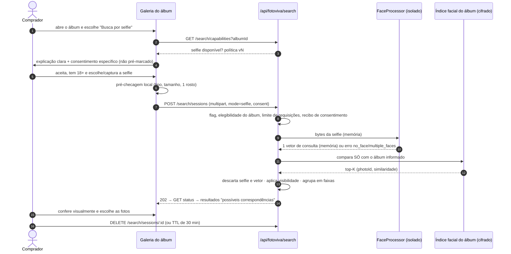

# F06 — Busca por selfie (reconhecimento facial)

> **Status:** ✅ fluxo, arquitetura e contrato projetados · ⛔ **BLOQUEADA para dados reais** até haver aprovação jurídica (RIPD), revisão do Codex e decisão formal
> **Feature flag:** `FV_FACE_SEARCH = off` (padrão) | `synthetic` (só no laboratório, só álbuns sintéticos). **Não existe o valor `on`** no código até a aprovação.
> A interface atual (`busca-selfie`, desativada) continua como está.

*Este documento não é parecer jurídico. As referências à LGPD indicam o que precisa de análise profissional.*

## 1. Por que está bloqueada

| Ponto | Detalhe |
|---|---|
| Dado biométrico é **dado pessoal sensível** | LGPD, art. 5º, II. O tratamento exige uma das hipóteses do art. 11; para o comprador, a mais provável é o **consentimento específico e destacado** (art. 11, I) |
| **Terceiros nas fotos** | Para encontrar o comprador, o sistema precisa gerar *templates* faciais de **todas as pessoas** das fotos do evento, que não deram consentimento. **Este é o bloqueio principal.** As hipóteses (termos de inscrição do organizador, opt-in no evento, legítimo interesse — inaplicável a dado sensível) precisam de análise jurídica |
| Crianças e adolescentes | LGPD, art. 14: melhor interesse e consentimento de um dos pais. Eventos escolares e esportivos infantis são comuns |
| Relatório de impacto | O RIPD (art. 38) é recomendado antes de ligar a funcionalidade |
| Retenção e eliminação | Art. 16: eliminar ao fim do tratamento. O D1 tem **Time Travel** (restauração a um ponto no tempo), então linhas apagadas continuam restauráveis durante a janela de retenção. Ver §5 |
| Abuso | Alguém pode enviar a foto de **outra pessoa** para encontrá-la |

**Atenuante importante:** as galerias já são públicas, e qualquer pessoa pode percorrer todas as prévias de um álbum. A busca por selfie **não expõe fotos novas**, só acelera a localização. Ainda assim, ela cria um dado sensível que não existia, por isso o bloqueio continua.

**Alternativa sem biometria (prioridade):** número de peito, horário EXIF e busca por roupas (F07). Juntos, cobrem boa parte dos casos de corrida e ciclismo.

## 2. Fluxo (quando for aprovado)



## 3. Regras obrigatórias

| Requisito do briefing | Como é atendido |
|---|---|
| Nunca identificar pessoas publicamente | Os resultados são só `photoId` + prévia com marca-d'água. Não há nome, perfil ou "quem é esta pessoa" |
| Sem banco biométrico geral | O índice é **por álbum**, cifrado com chave própria do álbum (§5). Não existe índice global nem por usuário |
| Sem busca entre eventos ou usuários | `albumId` é obrigatório e a consulta só abre o índice desse álbum. Sem "procurar em todos os eventos" |
| Sem treinamento externo | Nenhuma imagem ou vetor sai para terceiros. Modelos pré-treinados, sem *fine-tuning* com fotos de clientes |
| Sem embeddings permanentes | Os vetores da selfie **nunca** são gravados. Os do álbum expiram junto com a janela de vendas (`face_index_expires_at`) e são destruídos com a chave |
| Menores | Álbum com `may_include_minors = 1` (declarado pelo fotógrafo ou pela moderação) → selfie indisponível. O comprador declara ter 18 anos ou mais |
| Resultado ≠ identidade | Texto obrigatório: **"Possíveis correspondências — confira se é você."** A pontuação crua nunca é exibida; só as faixas `alta` e `media` |
| Flag desligada | Sem flag → `403 {code:"feature_disabled"}` (a interface mostra o estado `blocked` atual) |

## 4. Arquitetura técnica

### Porta e adaptadores

```ts
export interface FaceProcessor {
  readonly modelVersion: string;
  /** Detecta rostos e devolve um vetor por rosto. Nada é persistido. */
  embedFaces(image: Uint8Array): Promise<{ faces: { box: [number, number, number, number]; quality: number; vector: Float32Array }[] }>;
}
// SyntheticFaceProcessor: só para testes. Lê "identidades" sintéticas de fixtures (padrões geométricos, sem rosto humano).
// OnnxFaceProcessor: detector + reconhecedor auto-hospedados — 🔒 bloqueado.
```

### Modelos candidatos (avaliar quando houver aprovação)

| Função | Candidato | Licença informada pelo projeto | Observação |
|---|---|---|---|
| Detecção | YuNet (OpenCV Zoo) | MIT | Leve; pode rodar no navegador para a pré-checagem |
| Reconhecimento | SFace (OpenCV Zoo) | Apache-2.0 | Vetor de 128 dimensões |
| ⚠️ Evitar | Pesos pré-treinados do InsightFace | Uso **não comercial** | O código é MIT, mas os pesos não podem ser usados comercialmente sem licença |

> Confirme a licença na versão exata que for adotada; nada aqui substitui essa verificação.

### Onde roda

O Worker tem 128 MB de memória e limite de CPU por requisição. Detecção e reconhecimento de rosto não cabem lá com folga. Portanto:

- **Pré-checagem** (tipo, dimensões e quantidade de rostos) no navegador, só para dar retorno de UX. O servidor não confia nela.
- **Vetor da consulta** em um processador isolado e auto-hospedado, sem armazenamento local e sem log de payload. 🔒 depende de infraestrutura aprovada (custo).
- **Comparação** no Worker: produto escalar contra o índice do álbum, que é pequeno (≈ 3 rostos/foto × 10 mil fotos × 128 dim em int8 ≈ 3,8 MB).

### Limiares

- Calibrar com o **conjunto de avaliação consentido** (§6): medir FMR (falsa correspondência) e FNMR (falsa não correspondência).
- `alta`: FMR ≤ 0,1%; `media`: FMR ≤ 1%; abaixo disso, não exibir.
- Se a selfie tiver rosto pequeno (< 112 px), desfocado ou muito virado: `422 {code:"image_quality"}`, com dica de nova captura.

## 5. Retenção e eliminação

| Dado | Onde | Retenção | Como é eliminado |
|---|---|---|---|
| Bytes da selfie | Memória do Worker e do processador | Duração da requisição | Nunca gravados; proibidos em logs |
| Vetor da selfie | Memória | Duração da requisição | Nunca gravado |
| Sessão de busca | D1 `search_sessions` (photoIds + faixas) | 30 min | `DELETE` do usuário ou varredura por cron |
| Recibo de consentimento | D1 `consent_receipts` (hash da sessão, versão da política, álbum, data) | Prazo definido pelo jurídico | Não contém imagem nem vetor; serve para provar o consentimento |
| Índice facial do álbum | R2 privado, **cifrado** com AES-GCM e chave do álbum | Até `face_index_expires_at` (fim da janela de vendas) | **Destruição da chave**: apagar a chave torna o índice ilegível, inclusive em cópias restauradas. Depois disso, o objeto é apagado |

A chave por álbum fica no D1, cifrada com uma chave mestra guardada em `wrangler secret`. Como o Time Travel do D1 pode restaurar uma linha de chave apagada, a chave mestra precisa ser **rotacionada** depois de cada ciclo de destruição. O mecanismo exato será definido com o Codex.

## 6. Testes sem pessoas reais

- **Pipeline:** `SyntheticFaceProcessor` com fixtures geométricas que imitam "identidades" sem rosto humano. Cobre autorização, escopo do álbum, faixas, exclusão, cancelamento, limites e erros.
- **Modelo:** um **conjunto de avaliação consentido** montado pela equipe, com termo assinado por cada participante, sem menores e com finalidade restrita à calibração. É 🔒: precisa de aprovação.
- Bancos públicos de rostos de celebridades **não** devem ser usados: a base legal e as licenças são incertas.

## 7. Critérios para desbloquear

- [ ] RIPD concluído e parecer jurídico sobre a base legal para **terceiros** nas fotos.
- [ ] Política de privacidade e textos de consentimento aprovados (a página `/privacidade` está "em preparação").
- [ ] Revisão de segurança do Codex sobre esta arquitetura, a cifragem e a destruição de chaves.
- [ ] Processador auto-hospedado aprovado (custo e local de processamento).
- [ ] Limiares calibrados no conjunto consentido, com FMR e FNMR publicados internamente.
- [ ] Decisão formal registrada antes de criar o valor `on` da flag.
