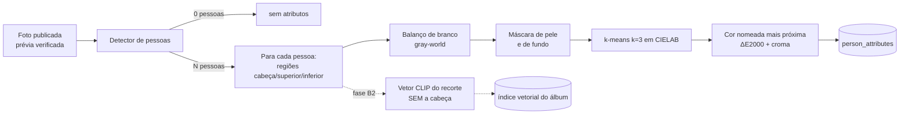

# F07 — Busca por roupas e características visuais

> **Status:** ✅ projetada · ✅ interpretador de consultas em pt-BR testado · 📝 falta implementar a classificação de cores e o índice (dependem do código-fonte)
> **Feature flag:** `FV_SEARCH_CLOTHING = off | synthetic | on`. `on` pode ser ligado no laboratório depois da revisão do Codex, porque **não envolve biometria**.
> **Prioridade:** esta é a alternativa principal à selfie.

## 1. O que o usuário pode fazer

| Entrada | Exemplo | Interpretação |
|---|---|---|
| Texto livre | "camisa vermelha e boné preto" | `[{camisa, superior, vermelho}, {bone, cabeca, preto}]`, **na mesma pessoa** |
| Seleção guiada | Chips: *Parte de cima* → *Azul*; *Acessório* → *Mochila* | A mesma estrutura, sem texto |
| Número | "camisa com número 1234" ou "#1234" | `bib = "1234"`, usando o campo `bib` que **já existe** |
| Imagem de referência | Foto de uma roupa ou de alguém vestido | Cores e, na fase B2, vetor visual do recorte da roupa (§4) |
| Filtros combinados | Álbum, data, categoria, horário EXIF | Reaproveita os filtros existentes da descoberta |

Exemplos do briefing e como são tratados:

| Consulta | Resultado do interpretador (testado) |
|---|---|
| blusa azul | `{blusa, superior, azul}` |
| camisa vermelha | `{camisa, superior, vermelho}` |
| uniforme branco | `{uniforme, corpo_inteiro, branco}` |
| camisa com número | `{camisa, superior}` (+ `bib` quando houver dígitos) |
| roupa preta | `{roupa, qualquer, preto}` |
| mochila | `{mochila, bolsa}` |
| boné | `{bone, cabeca}` |
| combinação de cores: "vermelho e azul" | `[{roupa, qualquer, vermelho}, {roupa, qualquer, azul}]` |
| "camisa do flamengo" | `{camisa}`; `unrecognized: ["flamengo"]`. O sistema avisa que não entendeu, em vez de inventar |

O interpretador é **determinístico, sem IA**: um vocabulário fechado com 12 cores, sinônimos (vinho → vermelho, celeste → azul, bege → marrom…), flexões (vermelha, vermelhos…) e plurais (calças, bonés). Ele aceita no máximo 5 itens por consulta. Código e testes estão em [codigo-de-referencia.md §3](codigo-de-referencia.md#3-interpretador-de-consultas-de-roupa).

## 2. Pipeline de indexação de uma foto



**Regras de recorte** (por pessoa, dentro da caixa do detector):

| Região | Faixa vertical da caixa | Uso |
|---|---|---|
| `cabeca` | 0–18% | Boné, chapéu ou viseira: **só a cor**. O rosto nunca é recortado para vetores |
| `superior` | 18–55% (60% centrais da largura) | Camisa, blusa, regata, jaqueta |
| `inferior` | 55–90% | Calça, short, saia |
| `bolsa` | Detecção de mochila ou bolsa (classe do detector) | Mochila, pochete |

**Classificação de cor:**

1. Balanço de branco *gray-world* por foto, para que a iluminação interfira menos.
2. Descartar pixels de pele (heurística em YCrCb) e de baixa saturação extrema perto das bordas da caixa.
3. Agrupar os pixels restantes com k-means (k = 3) em CIELAB e escolher o grupo dominante.
4. Se o croma for menor que 12, a cor é acromática: `preto` (L* < 30), `cinza` ou `branco` (L* > 80). Caso contrário, usar a cor da paleta com menor ΔE2000.
5. Confiança = fração do grupo dominante × (1 − ΔE normalizado).

## 3. Classificação dos resultados

Todos os itens da consulta precisam bater na **mesma pessoa**. Sem essa regra, "camisa vermelha + boné preto" casaria com uma foto em que uma pessoa usa camisa vermelha e **outra** usa boné preto. Esse é o falso positivo clássico.

```
pontuação(pessoa) = Σ_itens melhor_casamento(item, atributos da pessoa)
  casamento exato de cor e região  = 1,0 × confiança
  cor vizinha (tabela abaixo)       = 0,5 × peso_vizinhança × confiança
  região "qualquer"                 = melhor região disponível
pontuação(foto) = max(pontuação(pessoa)) + 0,1 × (tamanho relativo da pessoa)
faixa: alta ≥ 0,8 × nº de itens · media ≥ 0,5 × nº de itens · baixa: o resto (só se o usuário pedir "ver mais")
```

**Cores vizinhas** (para o caso "cores semelhantes"): azul ↔ azul_marinho 0,6; preto ↔ azul_marinho 0,5; vermelho ↔ laranja 0,4; vermelho ↔ rosa 0,4; amarelo ↔ laranja 0,4; preto ↔ cinza 0,4; branco ↔ cinza 0,4; azul ↔ roxo 0,3; marrom ↔ laranja 0,3.

Desempate: mais itens casados, depois maior pontuação, depois horário EXIF e, por fim, `photoId`. Assim a ordem é determinística.

## 4. Imagem de referência

1. **No navegador do comprador**, a imagem é decodificada, a pessoa é escolhida (a maior, ou outra que o usuário tocar) e as cores das regiões são calculadas.
2. Fase B1: o navegador envia **só os atributos** (`[{region, color, confidence}]`). **A imagem não sai do aparelho.**
3. Fase B2: o vetor CLIP do recorte **sem a cabeça** pode ser calculado no navegador, se o desempenho em celulares permitir, ou no processador auto-hospedado (🔒). Nesse caso, a imagem é processada em memória e descartada.
4. Caso o servidor precise receber a imagem: limite de 8 MB e 24 MP; JPEG, PNG ou WebP; a imagem nunca é gravada e é descartada ao fim da requisição.

## 5. Privacidade

| Risco | Medida |
|---|---|
| Virar perfil pessoal | Os atributos ficam ligados a `photoId` e `personIdx`, nunca a um usuário. Não existe "pessoa X aparece nestas fotos". Não há agrupamento de pessoas entre fotos |
| Reidentificação por roupa | Os vetores B2 excluem a cabeça, ficam **só no álbum** e são apagados com ele. Não existe busca entre álbuns |
| Envio a terceiros | Nenhum: tudo roda no navegador ou em infraestrutura própria. APIs de visão pagas estão proibidas |
| Fotos privadas | A busca aplica a mesma regra de visibilidade da descoberta **antes** de responder (F09 §3) |

## 6. Limitações conhecidas

- Cores próximas (azul-marinho × preto) e uniformes iguais (equipes, assessorias) geram empates. Nesses casos, o número de peito e o horário EXIF desempatam.
- Pessoas parcialmente cobertas, de costas ou muito pequenas (< 10% da altura da foto) são ignoradas.
- O tipo de peça (camisa × regata) só é distinguido na fase B2 (CLIP). Na fase B1, a busca considera **região + cor**.
- A qualidade depende do detector de pessoas. Detecção falha → a foto não aparece na busca por roupa, mas continua na galeria e nos filtros.
