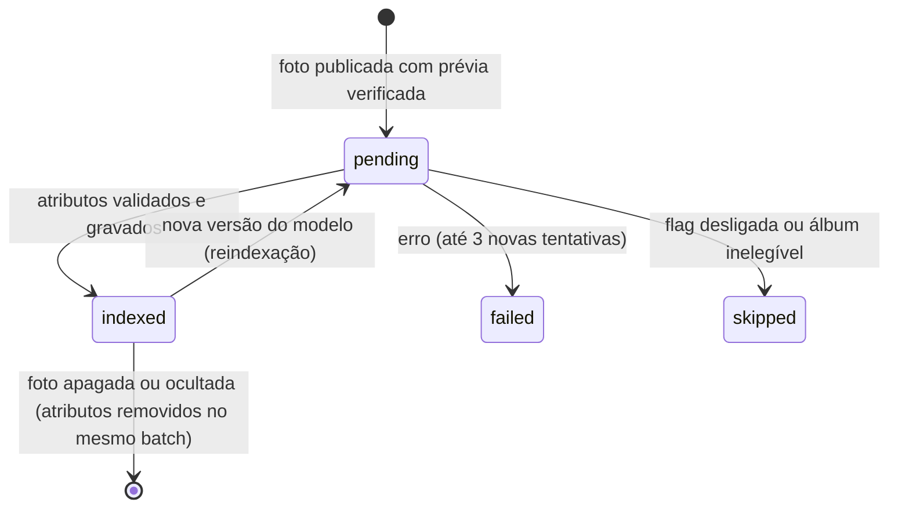

# F09 — Indexação e busca em álbuns

> **Status:** ✅ projetada · 📝 a implementação depende do código-fonte (tabelas de álbum e foto, regra de visibilidade existente)

## 1. Modelo de dados

```sql
-- Estado de indexação por foto
CREATE TABLE photo_search_index (
  photo_id TEXT PRIMARY KEY,
  album_id TEXT NOT NULL,            -- copiado do banco, nunca do payload
  photographer_id TEXT NOT NULL,     -- idem
  status TEXT NOT NULL CHECK (status IN ('pending','indexed','failed','skipped')),
  model_version TEXT,
  person_count INTEGER,
  indexed_at INTEGER,
  error TEXT
);
CREATE INDEX psi_album ON photo_search_index(album_id, status);

-- Atributos por pessoa detectada (fase B1)
CREATE TABLE person_attributes (
  photo_id TEXT NOT NULL,
  album_id TEXT NOT NULL,
  person_idx INTEGER NOT NULL CHECK (person_idx BETWEEN 0 AND 29),
  rel_height REAL NOT NULL,          -- altura da pessoa / altura da foto
  region TEXT NOT NULL CHECK (region IN ('cabeca','superior','inferior','corpo_inteiro','bolsa','pes')),
  color TEXT NOT NULL,               -- enum das 12 cores
  confidence REAL NOT NULL CHECK (confidence BETWEEN 0 AND 1),
  PRIMARY KEY (photo_id, person_idx, region)
);
CREATE INDEX pa_album_region_color ON person_attributes(album_id, region, color);

-- Sessões de busca temporárias (imagem de referência e selfie)
CREATE TABLE search_sessions (
  id TEXT PRIMARY KEY,               -- UUID; dá acesso só junto com o dono
  owner_subject TEXT NOT NULL,       -- sessão ou cookie anônimo
  album_id TEXT NOT NULL,
  mode TEXT NOT NULL CHECK (mode IN ('reference','selfie')),
  status TEXT NOT NULL CHECK (status IN ('queued','processing','done','failed','canceled','expired')),
  results_json TEXT,                 -- [{photoId, relevance}] — sem vetores
  error_code TEXT,
  created_at INTEGER NOT NULL,
  expires_at INTEGER NOT NULL        -- created_at + 30 min
);
CREATE INDEX ss_expires ON search_sessions(expires_at);
```

## 2. Ciclo de vida



| Evento existente | Efeito no índice (mesmo batch D1) |
|---|---|
| Álbum publicado (laboratório) | `photo_search_index` vira `pending` para as fotos com prévia verificada |
| Foto apagada | `DELETE FROM person_attributes WHERE photo_id=?` e `DELETE FROM photo_search_index WHERE photo_id=?`. O índice vetorial é marcado como `stale` |
| Álbum ocultado ou despublicado / moderação | `DELETE … WHERE album_id=?`; o objeto vetorial do álbum é apagado do R2 |
| Fotógrafo perde o papel | Os álbuns deixam de estar visíveis e a busca deixa de retornar fotos deles por causa da regra do §3 |

## 3. Autorização e visibilidade (antes de entregar resultados)

1. `albumId` é obrigatório. O álbum precisa satisfazer **exatamente a mesma regra** da descoberta pública (publicado, não ocultado pela moderação, prévias verificadas). **Essa regra deve ser uma função ou view única**, compartilhada pela galeria e pela busca, para que as duas não divirjam.
2. A consulta SQL faz `JOIN` com essa view, de modo que fotos privadas, rascunhos, ocultas ou apagadas **não podem** aparecer, mesmo que o índice esteja desatualizado.
3. O resultado contém só `photoId`, dimensões, URL da **prévia com marca-d'água** (`/api/fotoviva/previews/:id`) e o motivo do casamento. Chaves de R2 e URLs de originais nunca aparecem.
4. Uma sessão de busca só é lida, cancelada ou apagada por `owner_subject`. Para outras pessoas, a resposta é **404**.

Consulta B1 (esboço):

```sql
-- ?1 albumId · itens da consulta expandidos em VALUES (region, color, weight)
WITH q(region, color, weight) AS (VALUES (?2, ?3, 1.0), (?4, ?5, 1.0)),
vis AS (SELECT photo_id FROM visible_photos WHERE album_id = ?1)       -- mesma regra da galeria
SELECT pa.photo_id, pa.person_idx,
       SUM(pa.confidence * q.weight)            AS score,
       COUNT(DISTINCT q.region || q.color)      AS matched,
       MAX(pa.rel_height)                       AS size
FROM person_attributes pa
JOIN q   ON (q.region = pa.region OR q.region = 'qualquer') AND q.color = pa.color
JOIN vis ON vis.photo_id = pa.photo_id
WHERE pa.album_id = ?1
GROUP BY pa.photo_id, pa.person_idx
ORDER BY matched DESC, score DESC, size DESC, pa.photo_id
LIMIT 200;
```

> O agrupamento por `(photo_id, person_idx)` garante que todos os itens casem **na mesma pessoa**. As cores vizinhas (F07 §3) entram como linhas extras em `q`, com peso menor. Como podem voltar várias linhas por foto, a camada de aplicação mantém só a melhor pessoa de cada `photo_id`.

**Verificação** (node:sqlite, consulta "camisa vermelha + boné preto" no álbum A):

| Foto | Situação | Resultado |
|---|---|---|
| p1 | A mesma pessoa usa camisa vermelha e boné preto | 1º lugar, `matched = 2` ✅ |
| p2 | Uma pessoa usa camisa vermelha e **outra** usa boné preto | Só `matched = 1` por pessoa, então cai para uma faixa inferior ✅ |
| p3 | Foto não visível (privada), com atributos idênticos | **Não aparece** ✅ |
| p4 | Outro álbum, com atributos idênticos | **Não aparece** ✅ |

## 4. Desempenho

| Operação | Meta p95 | Como |
|---|---|---|
| Interpretar a consulta | < 1 ms | Função pura |
| Busca B1 em álbum de 10 mil fotos | < 300 ms | Índice `(album_id, region, color)`; `LIMIT 200`; paginação por cursor de 24 itens (o mesmo lote do carrinho) |
| Busca B2 (vetorial) | < 800 ms | §4 do F08 |
| Selfie (B3) | < 3 s | Processador isolado; resposta assíncrona por sessão |

## 5. Limites de requisição

| Recurso | Limite sugerido | Chave |
|---|---|---|
| Busca por texto ou atributos | 30/min | Sessão |
| Imagem de referência | 10/h | Sessão + IP-hash |
| Selfie | 5/h e 20/dia | Sessão + IP-hash |
| Envio de atributos pelo fotógrafo | 600/min | Fotógrafo |

Implementação: binding de Rate Limiting do Workers, se disponível no plano, ou contador em D1 por janela. Ao exceder: `429` com `retryAfterSeconds`.

## 6. Eliminação de dados temporários

| Dado | Regra |
|---|---|
| Imagem de referência ou selfie | Nunca gravada; processada em memória |
| `search_sessions` | `DELETE` do usuário → linha apagada na hora; cron a cada 5 min apaga `expires_at < agora` |
| Logs | Proibido registrar corpo, imagem, vetor ou texto da consulta. Registra-se apenas código, duração e `album_id` |
| Índice vetorial e facial de álbum apagado | Objeto R2 apagado; o facial passa também por destruição da chave (F06 §5) |

## 7. Associação correta

- `album_id` e `photographer_id` do índice vêm de `SELECT … FROM photos WHERE id = ?` no momento da gravação, nunca do cliente.
- Um teste de integridade periódico (cron no laboratório) verifica `person_attributes.album_id = photos.album_id` para todas as linhas. Divergência gera alerta e reindexação.
